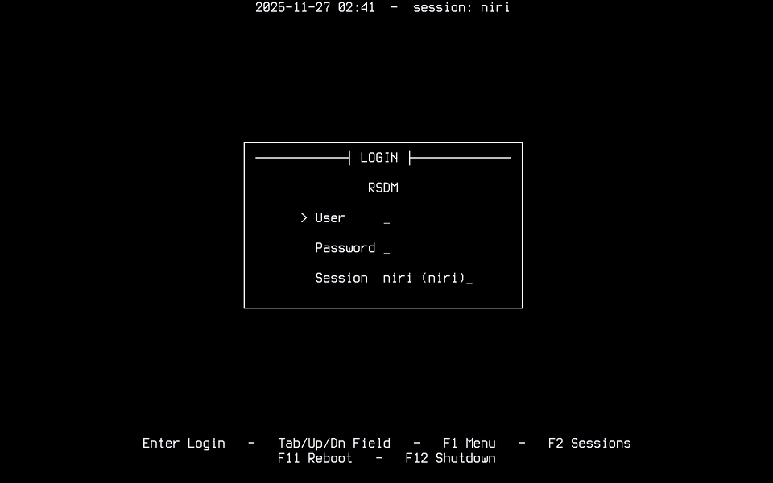

# RSDM

[](LICENSE)
[](https://frysuni.github.io/rsdm/)
[](https://github.com/Frysuni/rsdm/releases/latest)

> [!TIP]
> What happens when you take the evolution of [**greetd**](https://github.com/kennylevinsen/greetd) → [**tuigreet**](https://github.com/apognu/tuigreet) → [**sysc-greet**](https://github.com/Nomadcxx/sysc-greet), combine it with [**uwsm**](https://github.com/Vladimir-csp/uwsm), the responsibilities of a full display manager, [**hypridle**](https://github.com/hyprwm/hypridle), and [**hyprlock**](https://github.com/hyprwm/hyprlock), then rebuild the entire stack as one lightweight Rust binary?
>
> You get a deeply integrated system that handles native PAM authentication, session startup, environment management, idle behavior, and screen locking directly at the system level.
>
> No fragile chains of loosely connected tools. No endless configuration. No critical details left for the user to figure out.
>
> **One binary. One coherent login stack. Everything thoughtfully integrated.**
>
> **That is how RSDM was born.**

A standalone Rust display manager (TTY/TUI greeter) and screen locker for
Wayland sessions. No greetd, GTK, Qt, webview, or Electron - one small binary
that owns a virtual terminal, authenticates through PAM, and launches your
compositor.

- TTY/TUI Greeter (`rsdm dm`) with theme, border, animated background, generated
  FIGlet title, and a runtime `F1` design switcher.
- `ext-session-lock-v1` Lock (`rsdm lock`) that renders the same design on a
  software framebuffer, with optional wallpaper, dim, and animated background.
- Compositor-driven idle locking (`rsdm idle`) with confirmed-lock hooks and an
  optional user service.
- Optional uwsm-style systemd `--user` session manager (`rsdm session`,
  `rsdm app`) that exports the Wayland/XDG environment and closes registered
  applications before the compositor, with XSMP and native DE delegation.

[](docs/public/rsdm-preview.mp4)

> [!WARNING]
> RSDM is experimental. Keep a working console login when trying a new
> display manager. Save your work before testing logout or power actions.

## Install

| Distribution | Installation |
| --- | --- |
| NixOS | [Flake module and channels](docs/installation/nixos.md) |
| Arch Linux | [AUR packages](docs/installation/arch.md) |
| Fedora | [Source or release installation](docs/installation/fedora.md) |
| Ubuntu | [Source or release installation](docs/installation/ubuntu.md) |

Choose a guide to install the PAM and systemd integration as well as the binary.
For the supported platforms, protocols and test scope, see
[Compatibility](docs/compatibility.md).

## Commands

```sh
rsdm dm                      # the greeter, on the configured VT (usually via systemd)
rsdm lock                    # lock the current Wayland session
rsdm idle                    # lock automatically after the configured timeout
rsdm unlock                  # root-authorized emergency unlock
rsdm logs --follow           # combined DM/idle/lock journal
rsdm status                  # configuration and live lock state
rsdm session start -- niri-session # use niri's original native session wrapper
rsdm session stop            # prepare registered apps, then close the session
rsdm session cancel          # cancel preparation before infrastructure teardown
rsdm session status          # full/partial scope, capabilities and preparation results
rsdm power reboot            # prepare the current session and request reboot
rsdm power poweroff          # prepare the current session and request shutdown
rsdm app -- waybar           # launch a program into the graphical session
rsdm validate-config         # check the config
```

The CLI uses rounded panels, colored status badges and highlighted help with
examples for every command. `rsdm logs` shows timestamps, sources and severity
badges in the same palette; `--follow` streams new entries until Ctrl+C. Output
stays in normal scrollback. Pipes receive plain text; use
`env NO_COLOR=1 rsdm status` to disable terminal styling. See
[CLI output](docs/README.md#cli-output) for details.

Set `[lock].enable = true` before using Lock. Run Lock and session commands from
your Wayland desktop as your own user. DM normally starts as `rsdm.service`.
See the [command reference](docs/README.md) for the full CLI.

## Session Manager

Enabled by default when you log in through RSDM. Launch applications through
`rsdm app` and bind your compositor's logout action to `rsdm session stop`.

```sh
rsdm app --shutdown-timeout 60 --on-timeout cancel -- foot
```

RSDM gives registered apps time to save and exit while the compositor is still
running. This can reduce “did not shut down correctly” warnings on the next
launch. With verified native delegation, GNOME and Plasma keep their native
shutdown dialogs. Use `rsdm power reboot` or `rsdm power poweroff` for
session-aware power actions.

Requires Linux, systemd 250+, logind and a user bus. Application preparation
covers registered apps. Clean saves depend on the app's quit support.
See the [Session Manager guide](docs/session-manager.md) for compositor
bindings, quit commands and timeout policies.

## Documentation

**[Read the RSDM Wiki](https://frysuni.github.io/rsdm/)** for searchable guides,
examples and expandable technical references.

| Topic | Guide |
| --- | --- |
| Login, VT and session selection | [DM and Greeter](docs/display-manager.md) |
| Lock and automatic idle locking | [Lock](docs/lock.md) · [Idle](docs/idle.md) |
| Orderly logout and power | [Session Manager](docs/session-manager.md) |
| Themes, wallpaper and all options | [Configuration](docs/configuration.md) |
| Keyring integration | [Keyrings](docs/keyrings.md) |
| Compositor setup | [niri](docs/compositors/niri.md) · [Hyprland](docs/compositors/hyprland.md) · [Sway](docs/compositors/sway.md) |
| Recovery and diagnostics | [Troubleshooting](docs/troubleshooting.md) |
| Development and internals | [Development](docs/development.md) · [Architecture](docs/ARCHITECTURE.md) · [Security](docs/SECURITY.md) |

The administrative configuration is `/etc/rsdm.toml`. See the
[complete example](rsdm.toml). On NixOS, the module generates this file.

## Compatibility

RSDM targets Wayland on Linux. NixOS and niri have maintainer-tested setups;
the project includes isolated integration fixtures for other session providers
and applications. A distribution package or a successful build does not by
itself establish end-to-end desktop compatibility. See the
[compatibility matrix](docs/compatibility.md) for the distinction between
login, locking, idle and shutdown support.

Tested RSDM on a new setup? Please [submit a test report](https://github.com/Frysuni/rsdm/issues/new/choose)
with your distribution, compositor, keyring, configuration, and results.

## Build from source

```sh
nix build .#rsdm-unstable
# Or enter the dev shell and build with Cargo:
nix develop
cargo build --release --locked -p rsdm
```

Rust 1.89+ is required. See [development](docs/development.md) for system
dependencies, tests and the local documentation build.

## License

Licensed under [GNU GPLv3](LICENSE).

> [!NOTE]
> **RSDM is built with AI as an engineering tool.**
